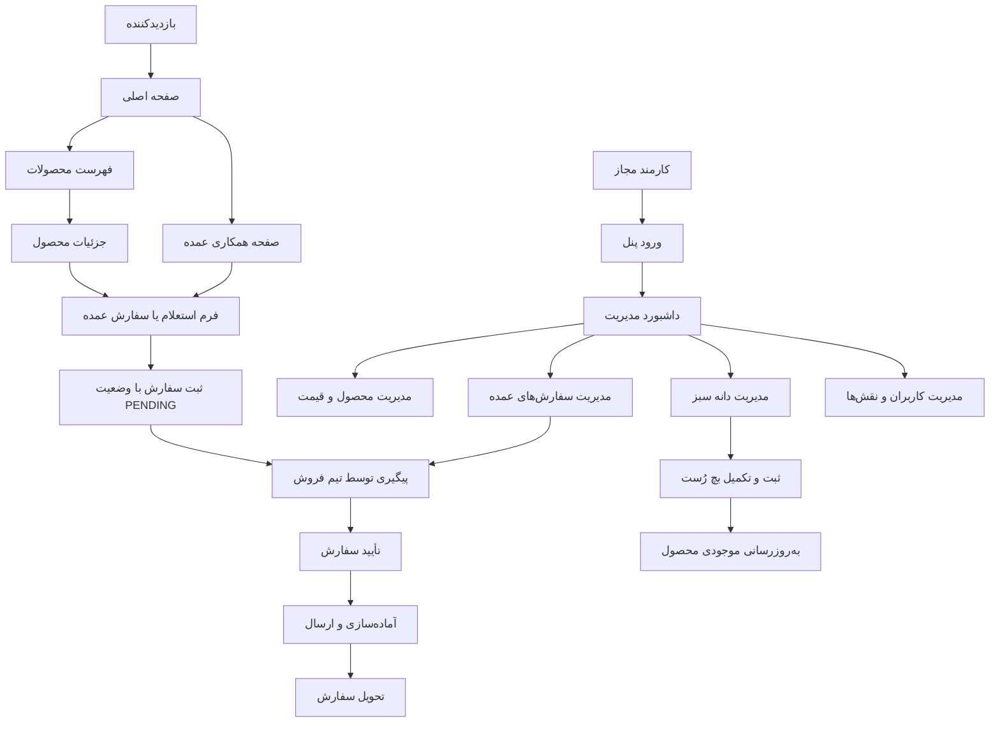

# سند معماری فنی کاراکافی

## ۱. روت‌ها و صفحات

### وب‌سایت عمومی

| مسیر | صفحه و هدف | دسترسی |
|---|---|---|
| `/` | معرفی کارخانه، مزیت‌ها، ظرفیت تولید و دسترسی به محصولات و استعلام عمده | عمومی |
| `/products` | فهرست محصولات فعال، دسته‌بندی و فیلتر محصولات | عمومی |
| `/products/[slug]` | جزئیات محصول، مشخصات رُست و بسته‌بندی، و درخواست قیمت عمده | عمومی |
| `/wholesale` | معرفی شرایط همکاری و فرم استعلام/ثبت سفارش عمده | عمومی |
| `/about` | معرفی کاراکافی، کارخانه و فرایند تولید | عمومی |
| `/contact` | اطلاعات تماس و فرم ارتباط با کارخانه | عمومی |

### پنل مدیریت

تمام مسیرهای پنل به‌جز ورود، نیازمند نشست معتبر کاربر مدیریتی هستند.

| مسیر | صفحه و هدف |
|---|---|
| `/admin/login` | ورود کارکنان مجاز |
| `/admin` | نمای کلی شاخص‌های تولید، موجودی و سفارش‌ها |
| `/admin/products` | فهرست، جست‌وجو و فعال/غیرفعال‌سازی محصولات |
| `/admin/products/new` | تعریف محصول |
| `/admin/products/[productId]` | ویرایش مشخصات، قیمت و موجودی محصول |
| `/admin/inventory/green-beans` | ثبت و مدیریت بچ‌های موجودی دانه سبز |
| `/admin/inventory/green-beans/[inventoryId]` | مشاهده و ویرایش محموله دانه سبز |
| `/admin/roast-batches` | فهرست، جست‌وجو و بررسی بچ‌های رُست |
| `/admin/roast-batches/new` | ثبت بچ تولید/رُست و مصرف دانه سبز |
| `/admin/roast-batches/[batchId]` | جزئیات، ویرایش و ثبت نتیجه بچ رُست |
| `/admin/orders` | صف سفارش‌های عمده و فیلتر بر اساس وضعیت |
| `/admin/orders/[orderId]` | جزئیات سفارش، اقلام، اطلاعات مشتری و تغییر وضعیت |
| `/admin/users` | مدیریت کاربران و نقش‌های پنل |
| `/admin/users/new` | ایجاد کاربر پنل |
| `/admin/users/[userId]` | ویرایش نقش و وضعیت کاربر |

نام پارامترهای مسیر مانند `slug`، `productId` و `orderId` بخشی از قرارداد رابط کاربری است. نام فیلدهای فرم‌ها و ستون‌های داده باید عیناً مطابق مدل‌های بخش بعد باشد.

## ۲. طراحی دیتابیس PostgreSQL و Prisma

### قواعد مشترک

- نام مدل‌ها و فیلدها مطابق قرارداد Prisma زیر و با حروف انگلیسی CamelCase است؛ همان نام‌ها در فرم‌ها، درخواست‌های داده و ستون‌های جدول فرانت‌اند استفاده می‌شوند.
- شناسه‌ها UUID هستند. زمان‌ها با `DateTime` و به‌صورت UTC ذخیره می‌شوند.
- مبلغ‌ها عدد صحیح بر حسب ریال‌اند؛ برای جلوگیری از خطای گردکردن اعشاری، قیمت از نوع `BigInt` است.
- وزن‌ها بر حسب کیلوگرم و از نوع `Decimal(10, 3)` هستند. تبدیل و نمایش ریال، کیلوگرم و ارقام فارسی بر عهده لایه نمایش است؛ نام کلید داده تغییر نمی‌کند.
- وضعیت‌های دسته‌بندی‌شده با enum نگهداری می‌شوند. `WholesaleOrder.items` آرایه JSON از اقلام سفارش است و هر قلم کلیدهای مشخص‌شده در پایین را دارد؛ نام محصول و قیمت هنگام ثبت سفارش در همان قلم snapshot می‌شود.

### مدل‌ها و فیلدها

#### `Product`

| فیلد | نوع پیشنهادی | الزام/کاربرد |
|---|---|---|
| `id` | `String @id @default(uuid())` | شناسه |
| `sku` | `String @unique` | کد یکتای محصول |
| `name` | `String` | نام نمایشی |
| `slug` | `String @unique` | شناسهٔ مسیر عمومی |
| `category` | `ProductCategory` | دسته محصول |
| `roastLevel` | `RoastLevel?` | درجه رُست، در صورت کاربرد |
| `description` | `String?` | توضیحات |
| `netWeightGrams` | `Int` | وزن بسته‌بندی به گرم |
| `wholesalePriceRial` | `BigInt` | قیمت عمده هر کیلوگرم |
| `retailPriceRial` | `BigInt?` | قیمت خرده‌فروشی هر بسته، اختیاری |
| `stockKg` | `Decimal(10, 3) @default(0)` | موجودی محصول رُست‌شده به کیلوگرم |
| `isActive` | `Boolean @default(true)` | نمایش/فروش فعال |
| `roastBatches` | `RoastBatch[]` | رابطه با بچ‌های خروجی؛ فیلد رابطه‌ای Prisma، نه ستون |
| `createdAt` | `DateTime @default(now())` | زمان ایجاد |
| `updatedAt` | `DateTime @updatedAt` | زمان آخرین ویرایش |

روابط: هر محصول می‌تواند خروجی چند `RoastBatch` داشته باشد. اقلام سفارش در JSON به محصول وابستهٔ زنده نیستند تا سابقه قیمت و نام سفارش حفظ شود؛ `productId` در قلم برای ارجاع نمایشی به محصول است، نه رابطه دیتابیسی.

#### `GreenBeanInventory`

| فیلد | نوع پیشنهادی | الزام/کاربرد |
|---|---|---|
| `id` | `String @id @default(uuid())` | شناسه |
| `lotCode` | `String @unique` | کد یکتای محموله دانه سبز |
| `originCountry` | `String` | کشور مبدأ |
| `region` | `String?` | منطقه یا خاستگاه |
| `producer` | `String?` | تولیدکننده/تعاونی |
| `process` | `String` | روش فرآوری |
| `harvestSeason` | `String?` | فصل برداشت |
| `stockKg` | `Decimal(10, 3)` | مقدار فعلی موجود |
| `reservedKg` | `Decimal(10, 3) @default(0)` | مقدار رزروشده برای تولید |
| `unitCostRial` | `BigInt` | بهای هر کیلوگرم به ریال |
| `minStockKg` | `Decimal(10, 3)` | حد هشدار کمبود |
| `supplierName` | `String?` | نام تأمین‌کننده |
| `receivedAt` | `DateTime` | تاریخ دریافت |
| `notes` | `String?` | توضیحات |
| `roastBatches` | `RoastBatch[]` | رابطه با بچ‌های مصرف‌کننده؛ فیلد رابطه‌ای Prisma، نه ستون |
| `createdAt` | `DateTime @default(now())` | زمان ایجاد |
| `updatedAt` | `DateTime @updatedAt` | زمان آخرین ویرایش |

روابط: هر محموله می‌تواند در چند `RoastBatch` مصرف شود. مقدار `stockKg` موجودی باقیمانده است و رزرو و مصرف باید در تراکنش دیتابیس کنترل شوند.

#### `RoastBatch`

| فیلد | نوع پیشنهادی | الزام/کاربرد |
|---|---|---|
| `id` | `String @id @default(uuid())` | شناسه |
| `batchCode` | `String @unique` | کد یکتای بچ تولید |
| `greenBeanInventoryId` | `String` | محمولهٔ دانه سبز مصرف‌شده |
| `productId` | `String?` | محصول خروجی، در صورت تخصیص |
| `plannedGreenKg` | `Decimal(10, 3)` | وزن برنامه‌ریزی‌شده دانه سبز |
| `actualGreenKg` | `Decimal(10, 3)?` | وزن واقعی دانه سبز مصرف‌شده |
| `outputRoastedKg` | `Decimal(10, 3)?` | وزن واقعی محصول رُست‌شده |
| `roastProfile` | `String?` | نام/شرح پروفایل رُست |
| `roastedAt` | `DateTime?` | زمان انجام رُست |
| `roastMaster` | `String?` | نام مسئول رُست |
| `status` | `RoastBatchStatus @default(PLANNED)` | وضعیت برنامه‌ریزی تا تکمیل |
| `notes` | `String?` | توضیحات عملیاتی |
| `greenBeanInventory` | `GreenBeanInventory` | رابطهٔ اجباری با محموله دانه سبز |
| `product` | `Product?` | رابطهٔ اختیاری با محصول خروجی |
| `createdAt` | `DateTime @default(now())` | زمان ثبت |
| `updatedAt` | `DateTime @updatedAt` | زمان آخرین ویرایش |

روابط: `greenBeanInventoryId` به `GreenBeanInventory.id` و `productId` به `Product.id` متصل می‌شود. کاهش موجودی دانه سبز و افزایش `Product.stockKg` فقط هنگام تکمیل بچ و در یک تراکنش انجام شود.

#### `WholesaleOrder`

| فیلد | نوع پیشنهادی | الزام/کاربرد |
|---|---|---|
| `id` | `String @id @default(uuid())` | شناسه |
| `orderNumber` | `String @unique` | شماره قابل‌نمایش سفارش |
| `businessName` | `String` | نام کافه/شرکت |
| `contactName` | `String` | نام شخص پاسخ‌گو |
| `phone` | `String` | شماره تماس |
| `email` | `String?` | ایمیل |
| `province` | `String` | استان |
| `city` | `String` | شهر |
| `deliveryAddress` | `String` | نشانی تحویل |
| `items` | `Json` | آرایه اقلام سفارش با ساختار زیر |
| `subtotalRial` | `BigInt` | جمع اقلام |
| `discountRial` | `BigInt @default(0)` | تخفیف |
| `shippingCostRial` | `BigInt @default(0)` | هزینه ارسال |
| `totalRial` | `BigInt` | مبلغ نهایی |
| `status` | `WholesaleOrderStatus @default(PENDING)` | وضعیت رسیدگی |
| `requestedDeliveryAt` | `DateTime?` | زمان درخواستی تحویل |
| `customerNote` | `String?` | یادداشت مشتری |
| `internalNote` | `String?` | یادداشت داخلی کارکنان |
| `createdAt` | `DateTime @default(now())` | زمان ثبت |
| `updatedAt` | `DateTime @updatedAt` | زمان آخرین ویرایش |

هر شیء در `items` دقیقاً این کلیدها را دارد: `productId`، `productName`، `sku`، `quantityKg`، `unitPriceRial` و `lineTotalRial`. `quantityKg` به‌صورت عدد اعشاری کیلوگرم است؛ `unitPriceRial` قیمت هر کیلوگرم و جمع‌ها به ریال صحیح هستند.

#### `User`

| فیلد | نوع پیشنهادی | الزام/کاربرد |
|---|---|---|
| `id` | `String @id @default(uuid())` | شناسه |
| `fullName` | `String` | نام کامل |
| `email` | `String @unique` | نام کاربری/ایمیل ورود |
| `passwordHash` | `String` | فقط هش امن رمز عبور؛ هرگز رمز خام ذخیره نشود |
| `role` | `UserRole @default(SALES_MANAGER)` | نقش و سطح دسترسی |
| `isActive` | `Boolean @default(true)` | امکان ورود |
| `lastLoginAt` | `DateTime?` | آخرین ورود |
| `createdAt` | `DateTime @default(now())` | زمان ایجاد |
| `updatedAt` | `DateTime @updatedAt` | زمان آخرین ویرایش |

### Enumها

- `ProductCategory`: `SINGLE_ORIGIN`، `BLEND`، `ESPRESSO`
- `RoastLevel`: `LIGHT`، `MEDIUM`، `DARK`
- `RoastBatchStatus`: `PLANNED`، `ROASTING`، `COMPLETED`، `CANCELLED`
- `WholesaleOrderStatus`: `PENDING`، `CONTACTED`، `CONFIRMED`، `PROCESSING`، `SHIPPED`، `DELIVERED`، `CANCELLED`
- `UserRole`: `ADMIN`، `PRODUCTION_MANAGER`، `SALES_MANAGER`

### نمونه داده فارسی برای آزمون اولیه

شناسه‌های رابطه در نمونه‌ها نمادین‌اند؛ هنگام seed باید UUID واقعی ساخته و ارجاع‌ها حفظ شوند.

#### محصولات (`Product`)

| id | sku | name | slug | category | roastLevel | description | netWeightGrams | wholesalePriceRial | retailPriceRial | stockKg | isActive |
|---|---|---|---|---|---|---|---:|---:|---:|---:|---|
| `product-001` | `KAR-ESP-01` | اسپرسو ترکیب کارا | `kara-espresso` | `BLEND` | `MEDIUM` | ترکیب متعادل عربیکا و روبوستا با نت شکلات تلخ و مغزها | 1000 | 3850000 | 4600000 | 86.500 | true |
| `product-002` | `KAR-ETH-01` | اتیوپی سیدامو | `ethiopia-sidamo` | `SINGLE_ORIGIN` | `LIGHT` | قهوه تک‌خاستگاه با رایحه گل و طعم مرکبات | 250 | 5680000 | 1690000 | 24.000 | true |

در ردیف‌های بالا و نمونه‌های بعدی، فیلدهای `createdAt` و `updatedAt` با زمان seed آزمون مقداردهی می‌شوند.

#### موجودی دانه سبز (`GreenBeanInventory`)

| id | lotCode | originCountry | region | producer | process | harvestSeason | stockKg | reservedKg | unitCostRial | minStockKg | supplierName | receivedAt | notes |
|---|---|---|---|---|---|---|---:|---:|---:|---:|---|---|---|
| `green-001` | `GB-ETH-1405-14` | اتیوپی | سیدامو | تعاونی کشاورزان بنسا | شسته | ۲۰۲۵/۲۰۲۶ | ۱۶۲.۰۰۰ | ۰.۰۰۰ | ۲۴۸۰۰۰۰ | ۳۰.۰۰۰ | بازرگانی دانه سبز | `2026-10-12T08:00:00Z` | عطر یاس و مرکبات |
| `green-002` | `GB-BRA-1405-09` | برزیل | سرادو | کوآپراتیو سرادو | طبیعی | ۲۰۲۵/۲۰۲۶ | ۹۴.۰۰۰ | ۰.۰۰۰ | ۱۹۵۰۰۰۰ | ۲۵.۰۰۰ | واردات قهوه سپهر | `2026-10-20T08:00:00Z` | مناسب ترکیب اسپرسو |

#### بچ‌های رُست (`RoastBatch`)

| id | batchCode | greenBeanInventoryId | productId | plannedGreenKg | actualGreenKg | outputRoastedKg | roastProfile | roastedAt | roastMaster | status | notes |
|---|---|---|---|---:|---:|---:|---|---|---|---|---|
| `batch-001` | `RB-1405-021` | `green-001` | `product-001` | 60.000 | 60.000 | 49.200 | اسپرسو، توسعه متوسط | `2026-11-18T07:30:00Z` | علی رضایی | `COMPLETED` | افت وزن مطابق برنامه |
| `batch-002` | `RB-1405-022` | `green-002` | `product-002` | 24.000 | 24.000 | 19.680 | روشن، توسعه کوتاه | `2026-11-20T08:00:00Z` | سارا محمدی | `COMPLETED` | برای بسته‌بندی ۲۵۰ گرمی |

#### سفارش‌های عمده (`WholesaleOrder`)

| id | orderNumber | businessName | contactName | phone | email | province | city | deliveryAddress | items | subtotalRial | discountRial | shippingCostRial | totalRial | status | requestedDeliveryAt | customerNote |
|---|---|---|---|---|---|---|---|---|---|---:|---:|---:|---:|---|---|---|
| `order-001` | `KC-1405-0081` | کافه نارون | مریم کریمی | `09121234567` | `orders@narvancafe.ir` | تهران | تهران | خیابان ولیعصر، خیابان ناهید، پلاک ۲۱ | `[{"productId":"product-001","productName":"اسپرسو ترکیب کارا","sku":"KAR-ESP-01","quantityKg":12,"unitPriceRial":3850000,"lineTotalRial":46200000}]` | 46200000 | 1000000 | 450000 | 45650000 | `CONFIRMED` | `2026-11-26T08:00:00Z` | ارسال در ساعات صبح |
| `order-002` | `KC-1405-0082` | پخش قهوه سپهر | امیر زمانی | `09351234567` | `buy@sepehrcoffee.ir` | اصفهان | اصفهان | خیابان چهارباغ بالا، کوچه ۱۲، پلاک ۸ | `[{"productId":"product-001","productName":"اسپرسو ترکیب کارا","sku":"KAR-ESP-01","quantityKg":20,"unitPriceRial":3750000,"lineTotalRial":75000000},{"productId":"product-002","productName":"اتیوپی سیدامو","sku":"KAR-ETH-01","quantityKg":5,"unitPriceRial":5680000,"lineTotalRial":28400000}]` | 103400000 | 0 | 1200000 | 104600000 | `PENDING` | `2026-11-29T08:00:00Z` | پیش از ارسال هماهنگ شود |

## ۳. جریان کاربر

